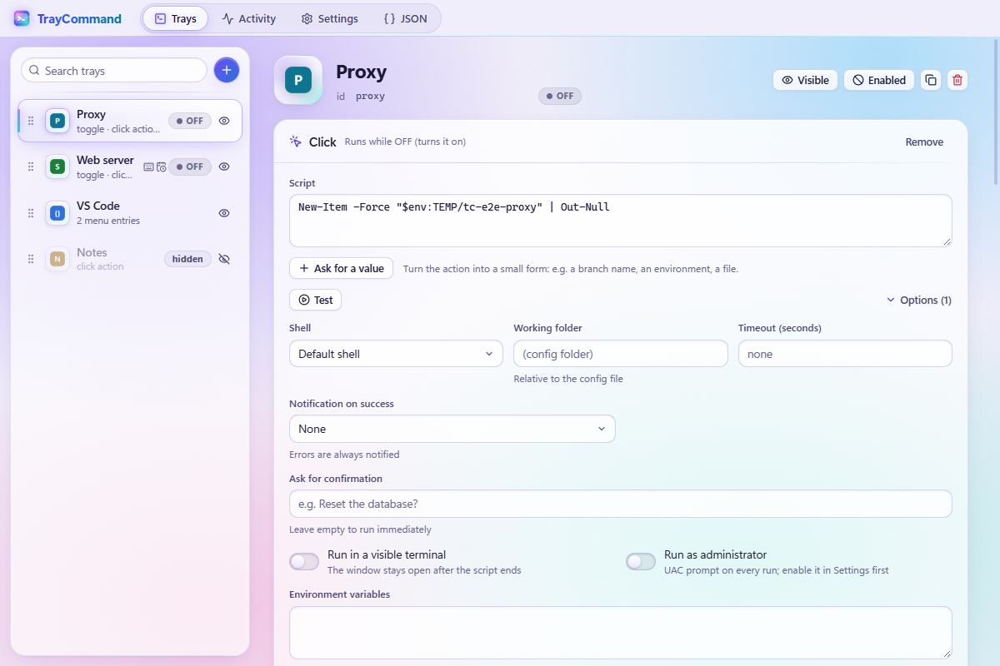
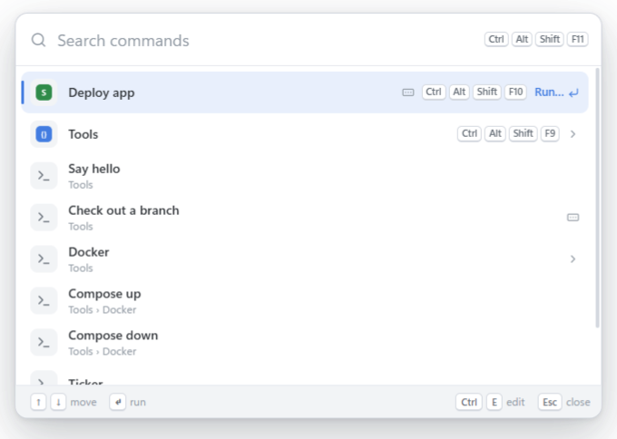

# TrayCommand

**Your commands, one click away.** TrayCommand puts tray icons on your desktop that run shell commands: open apps and projects, start and stop services, flip settings on and off — with a live ON/OFF state, menus and sub menus.



- **Toggles with a live state**: a check script decides whether an entry is ON or OFF; the icon and the menu follow it.
- **Hide without deleting**, disable, reorder, duplicate.
- **Keyboard launcher**: <kbd>Ctrl</kbd>+<kbd>Alt</kbd>+<kbd>Space</kbd>, type a few letters, <kbd>Enter</kbd>. Fuzzy search on every entry, recent first.
- **Global shortcuts** for any entry, **forms** that ask for values before a command runs (text, choices, files, passwords), and **schedules** (cron, intervals, at startup).
- **Test any command from the editor** and see its output and exit code.
- **Compose actions**: run other entries before, together with, or after an action.
- **Start at login without admin rights**: a shortcut in your Startup folder. No Task Scheduler, no registry.
- **Ask your AI agent**: TrayCommand installs a skill for Claude Code and opencode, so you can just ask *"add a tray that starts my Docker stack"*.
- **Per-user install and self update** from GitHub releases, verified with SHA-256.
- Windows, Linux (AppImage) and macOS.



📖 **Documentation:** https://cristianociuti.github.io/traycommand/
⬇️ **Download:** https://github.com/CristianoCiuti/traycommand/releases/latest

## Configuration in a nutshell

```json
{
  "$schema": "https://cristianociuti.github.io/traycommand/schema/v2/config.schema.json",
  "version": 2,
  "trays": [
    {
      "id": "server",
      "label": "Web server",
      "icon": "icons/server.png",
      "state": { "check": "Get-Process nginx -ErrorAction SilentlyContinue", "iconOff": "icons/server-off.png" },
      "action": "Start-Process C:/nginx/nginx.exe -WorkingDirectory C:/nginx -WindowStyle Hidden",
      "offAction": "Stop-Process -Name nginx -Force",
      "menu": [{ "label": "Edit nginx.conf", "action": "Start-Process notepad C:/nginx/conf/nginx.conf" }]
    }
  ]
}
```

See the [configuration reference](https://cristianociuti.github.io/traycommand/reference/) for everything else.

## Development

Requirements: Node.js 22+.

```bash
npm install
npm start            # build and run
npm test             # unit tests (vitest)
npm run test:e2e     # end-to-end tests on Electron (Playwright), screenshots in test-results/
npm run package      # zip / AppImage / mac zip in packages/
npm run site:dev     # documentation site
```

Project layout:

| Folder | What |
|---|---|
| `src/shared` | configuration schema (zod → TypeScript types, validation, JSON Schema), shared API types |
| `src/main` | Electron main process: engine, runner, trays, autostart, install, updates, elevation |
| `src/preload` | the bridge exposed to the UI |
| `src/ui` | editor UI (Preact + signals, Vite) |
| `site` | documentation (VitePress), published on GitHub Pages |
| `scripts` | build, icons, JSON Schema, 1.x converter |

Releases: bump `version` in `package.json`, add the notes to `site/changelog.md`, then push a tag `vX.Y.Z`. The `Release` workflow builds every platform and publishes the release with `SHA256SUMS`.

## License

[MIT](LICENSE)
