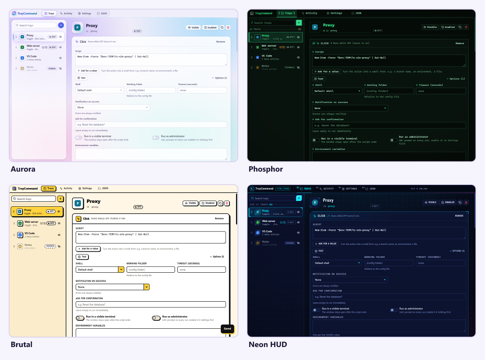

# TrayCommand

**Your commands, one click away.** TrayCommand puts tray icons on your desktop that run shell commands: open apps and projects, start and stop services, flip settings on and off — with a live ON/OFF state, menus and sub menus.


- **Toggles with a live state**: a check script decides whether an entry is ON or OFF; the icon and the menu follow it.
- **Keyboard launcher**: <kbd>Ctrl</kbd>+<kbd>Alt</kbd>+<kbd>Space</kbd>, type a few letters, <kbd>Enter</kbd>. Fuzzy search on every entry, recent first.
- **Global shortcuts** for any entry, and **forms** that ask for values before a command runs (text, choices, files, passwords).
- **Schedules**: at set times, at an interval, at startup or **when files appear in a folder**; within a time window, **only if a check passes**, after **asking you with an alert** that offers a few choices.
- **Four looks**: Aurora (default), Phosphor, Brutal and Neon HUD, light or dark. Each restyles the whole app and has its own icon.
- **Variables and secrets**: write a value once, use it everywhere as `${NAME}`; the editor offers them as chips while you type, shows where each is used and renames it there too. Secrets (passwords, tokens) stay encrypted on your PC, never in the file, and show as `••••` everywhere.
- **Export and import**: share some trays, schedules, variables or settings (with their icons) as a file; on import see what changes and choose what to do with what is already there.
- **Test any command from the editor** and see its output and exit code.
- **Compose actions**: run other entries before, together with, or after an action.
- **Hide without deleting**, disable, reorder, duplicate.
- **Start at login without admin rights**: a shortcut in your Startup folder. No Task Scheduler, no registry.
- **Ask your AI agent**: TrayCommand installs a skill for Claude Code and opencode, so you can just ask *"add a tray that starts my Docker stack"*.
- **Per-user install and self update** from GitHub releases, verified with SHA-256.
- Windows, Linux (AppImage) and macOS.

📖 **Documentation:** https://cristianociuti.github.io/traycommand/
⬇️ **Download:** https://github.com/CristianoCiuti/traycommand/releases/latest


## Four looks

Choose one in **Settings → Look** (`"style"` in the settings). The window buttons, the taskbar icon, the TrayCommand tray icon and the Start menu shortcut follow it.



## Configuration in a nutshell

Everything lives in one JSON file, which you can edit in the app or by hand; the running app applies changes as soon as the file is saved.

```json
{
  "$schema": "https://cristianociuti.github.io/traycommand/schema/v2/config.schema.json",
  "version": 2,
  "settings": { "style": "aurora" },
  "trays": [
    {
      "id": "server",
      "label": "Web server",
      "icon": "icons/server.png",
      "state": { "check": "Get-Process nginx -ErrorAction SilentlyContinue", "iconOff": "icons/server-off.png" },
      "action": "Start-Process C:/nginx/nginx.exe -WorkingDirectory C:/nginx -WindowStyle Hidden",
      "offAction": "Stop-Process -Name nginx -Force",
      "menu": [{ "label": "Edit nginx.conf", "action": "Start-Process notepad C:/nginx/conf/nginx.conf" }],
      "schedules": [{ "cron": "0 8 * * 1-5", "run": "on" }]
    }
  ]
}
```

See the [configuration reference](https://cristianociuti.github.io/traycommand/reference/) for everything else.

## Development

Requirements: Node.js 22+.

```bash
npm install
npm start            # build and run
npm test             # unit tests with coverage (vitest; the build fails below 100% on the app logic)
npm run test:e2e     # end-to-end tests on Electron (Playwright), screenshots in test-results/
npm run package      # zip / AppImage / mac zip in packages/
npm run site:dev     # documentation site
```

Project layout:

| Folder | What |
|---|---|
| `src/shared` | configuration schema (zod → TypeScript types, validation, JSON Schema), schedules, export/import logic, shared API types |
| `src/main` | Electron main process: engine, runner, trays, launcher, alerts, folder watches, export/import files, autostart, install, updates, elevation |
| `src/preload` | the bridge exposed to the UI |
| `src/ui` | editor and launcher UI (Preact + signals, Vite) |
| `src/ui/themes` | the four looks, one self-contained folder each (`tokens.css`, `styles.css`, `launcher.css`) |
| `assets` | app icons (one per look) and the macOS tray template |
| `site` | documentation (VitePress, Aurora theme), published on GitHub Pages |
| `skill` | the TrayCommand skill for AI agents |
| `scripts` | build, icons, JSON Schema, look audit, 1.x converter |

Tests: `test/unit` (logic, 100% coverage required) and `test/e2e` (`app`, `launcher`, `looks`, `transfer` run in CI on Windows; `packaged` checks a built executable with `TC_EXE`).

Branches and releases: work happens on `develop` (with `version` in `package.json` and the notes in `site/changelog.md` updated there). A release merges `develop` into `main` and pushes the tag `vX.Y.Z`: the `Release` workflow builds every platform and publishes the release with `SHA256SUMS`, and pushing `main` publishes the documentation.

## License

[MIT](LICENSE)
